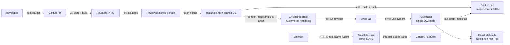

# React, K3s, and Argo CD: Complete Hands-on Guide

Build a small React application, validate pull requests, then after a merge
build and test again, publish an immutable Docker image to Docker Hub, and let
Argo CD deploy it to K3s on one Amazon EC2 instance. The Kubernetes manifests
are the desired state: Actions records the published image tag in Git, and
Argo CD applies that Git change to the cluster.

> **AWS cost warning:** K3s and Argo CD are open source, but EC2, EBS storage,
> public IPv4 addresses, and data transfer can cost money. A free-trial credit
> is not a promise that a chosen instance is Free Tier eligible or free.
> A `t3.medium` (2 vCPU, 4 GiB RAM) is a more realistic single-node learning
> host for K3s + Argo CD + this app, and may be billable. Check current regional
> prices, domain registration, public IPv4 charges, and Free Tier eligibility
> before launching. Create a budget alert,
> stop the instance when idle, and terminate it plus its storage when finished.

## 1. How the pieces fit



**Important:** Argo CD watches Git and the image tag recorded in the Kubernetes
manifest; it does not watch Docker Hub for tag changes in this design. Actions
first pushes a unique image tag such as
`docker.io/dockerhub-user/k8s-app-deployment:<full-commit-sha>`, then commits
that exact tag into the active/inactive Deployment manifest under `k8s/base/`.
Argo CD detects the Git revision and deploys the image.

This sample uses **blue/green** with two Deployments, `deploylab-blue` and
`deploylab-green`, and one Service. On the first CD run both slots receive the
same image and the Service starts on blue. On later releases CD updates only
the inactive slot and changes the Service's slot selector in the same Git
commit. Argo CD sync waves keep the Service at wave 1 and both Deployments at
wave 0; Argo CD waits for the wave-0 Deployments to report Healthy (including
the new Pod passing its readiness probe) before applying the Service switch.
The previously active slot stays running on its previous image, making a
traffic rollback quick. This needs both app replicas to fit on the one EC2
node; check the sizing and resource requests before deployment.
Blue/green separates application releases, but it does not by itself provide
high availability for a single EC2 node; losing that node takes down both
colors.

### Repository responsibilities

| Repository | Contents |
|---|---|
| `k8s-app-deployment` | React app, container build, Kubernetes desired state, Argo CD Application, caller workflows, this guide |
| `ci-cd-pipelines` | Two reusable Actions workflows: pull-request CI and main-branch CD |

The sample uses public GitHub repositories and a public Docker Hub repository
so neither Argo CD nor K3s needs a GitHub credential or image pull secret. Do
not publish proprietary source or images publicly. Private Git or image
repositories need separately configured read credentials for Argo CD and
Kubernetes.

## 2. Create the GitHub repositories

Create two GitHub repositories owned by the same account or organization:

1. `k8s-app-deployment` — use the existing app repository if it has already
   been created.
2. `ci-cd-pipelines` — use the repository containing the reusable Actions
   workflows.

For this learning flow, set both GitHub repositories to **Public**. Reusable
workflows in a public `ci-cd-pipelines` repository can be called by the app
repository. Create a public Docker Hub repository named
`k8s-app-deployment` under your Docker Hub account so K3s can pull the image
without credentials.

Replace `OWNER` with your GitHub account or organization in:

- `.github/workflows/ci.yml`
- `.github/workflows/cd.yml`
- `argocd/application.yaml`

The Docker Hub username in the initial blue/green Deployment image placeholders
is replaced by the first successful CD promotion; it is not the GitHub `OWNER`.

Commit and push this project to the app repository's `main` branch. Commit and
push `ci-cd-pipelines` to its `main` branch as well. The workflow reference
uses `@main` for ease of learning; in production, use an approved release tag
or commit SHA.

### Workflow permissions

The pull-request CI workflow needs only `contents: read` and receives no
Docker Hub credentials. The main-branch CD workflow receives
`DOCKERHUB_USERNAME` and `DOCKERHUB_TOKEN` to publish the image and uses
`contents: write` only in its manifest promotion job. No AWS access keys, SSH
private key, Kubernetes admin credentials, or IAM OIDC role is needed by GitHub
Actions: Argo CD pulls desired state from Git and K3s pulls the public Docker
Hub image.

GitHub only recognizes workflow files directly in `.github/workflows/`.
Therefore executable reusable workflows are grouped with repository-name
prefixes in that directory (for example, `k8s-app-deployment-ci.yml`), rather
than nested in subfolders. `taskboard-java.yml` remains alongside them at that
required workflow root.

For organization repositories, check organization Actions policy if the caller
cannot access the public reusable workflows.

### Docker Hub and GitHub setup

1. In Docker Hub, create a public repository named `k8s-app-deployment`.
   The resulting image reference will be
   `docker.io/<dockerhub-username>/k8s-app-deployment:<commit-sha>`.
2. In Docker Hub account settings, create an access token with read/write
   permissions for publishing. Do not use your Docker Hub account password.
3. In the `k8s-app-deployment` GitHub repository, open **Settings → Secrets
   and variables → Actions → New repository secret** and add:

   | Secret | Value |
   |---|---|
   | `DOCKERHUB_USERNAME` | Your Docker Hub username |
   | `DOCKERHUB_TOKEN` | The Docker Hub access token |

4. In GitHub repository **Settings → Actions → General**, make sure Actions
   are allowed to call the public reusable workflows in `ci-cd-pipelines`.
5. Protect `main` with pull requests and require the `React CI / validate`
   status check before merge. The CD bot commits manifest promotions directly
   to `main`; a branch rule that rejects bot pushes will make that job fail.
   Workflow refs use `@main` for ease of learning; pin them to an approved tag
   or full commit SHA for production.

## 3. Run the React app locally

Install Node.js 22.12 or later. From the project root, use the Vite development
server:

```powershell
npm ci
npm test
npm run build
npm run dev
```

Open the local URL printed by Vite (normally <http://localhost:5173>). The page
is a learning dashboard illustrating the sample release path; its displayed
steps are illustrative, not live Kubernetes status or telemetry. Stop the
server with `Ctrl+C`.

Docker Compose is not part of this deployment. K3s schedules and runs the
application containers in the cluster. If you specifically want to verify the
production image locally, build and run it directly:

```powershell
docker build -t deploylab:local .
docker run --rm -p 8080:8080 deploylab:local
```

Then open <http://localhost:8080>.

The production image uses a multi-stage build and an unprivileged Nginx runtime.
The manifest also enforces non-root execution, drops Linux capabilities, uses
a read-only root filesystem, and sets CPU/memory requests and limits.

## 4. Create a low-cost single-node K3s EC2 host

K3s is a lightweight, certified Kubernetes distribution. Argo CD runs on K3s
like other Kubernetes workloads; it is not limited to EKS. This guide uses one
K3s server node to keep the learning setup simple. It is not highly available
or production architecture.

### 4.1 Choose and budget the instance

In the AWS console, choose a region near you and create a budget alert before
launching. For a usable K3s + Argo CD host, consider a current-generation
instance with 2 vCPU and 4 GiB RAM (for example, `t3.medium` where available)
and at least 20 GiB gp3 storage. Instance availability, Free Tier rules, and
pricing vary by account, region, and date. If your free-trial budget cannot
cover this, run the cluster locally with `kind` or `minikube` first and do not
launch an undersized EC2 instance just to avoid checking costs.

Create a guardrail in **Billing and Cost Management → Budgets → Create budget**.
Choose a cost budget, set a limit you are willing to spend beyond any trial
credits, and add email alerts at multiple thresholds (for example, 50%, 80%,
and 100%). A budget alert notifies you; it does not automatically stop or
terminate resources.

Use Amazon Linux 2023. Create or select an EC2 key pair if you want SSH as a
break-glass option. Prefer Systems Manager Session Manager for administration.

### 4.2 Instance role and security group

In the AWS console, create the EC2 role before launching the instance:

1. Open **IAM → Roles → Create role** and select **AWS service → EC2** as the
   trusted entity.
2. Attach the AWS-managed policy `AmazonSSMManagedInstanceCore`.
3. Name it `K3sSessionManagerRole` and create it. The EC2 role is made available
   to instances through an instance profile; select this role at launch.
4. Do not add broad administrator permissions to the instance role. This
   workload does not need AWS API access to deploy the app.

Attach that role to the EC2 instance so Session Manager can administer the
host without opening inbound SSH. Confirm that the instance can reach the
internet over outbound HTTPS (K3s install, GitHub, Docker Hub, and Systems Manager
need outbound access).

Create an EC2 security group with:

| Direction | Protocol/port | Source | Purpose |
|---|---:|---|---|
| Inbound | TCP 80 | `0.0.0.0/0` | Public HTTP; Traefik redirects app requests to HTTPS and Let's Encrypt uses HTTP-01 validation |
| Inbound | TCP 443 | `0.0.0.0/0` | Public HTTPS application traffic |
| Inbound | TCP 22 | None by default | Use Session Manager; only add SSH from My IP if explicitly needed |
| Outbound | Default allow all | `0.0.0.0/0` | K3s install, GitHub/Docker Hub, and Session Manager; narrow later if desired |

These public web ports are intentional: they serve the website to visitors
from any IP, so your changing home IP does not need to be maintained. Do not
add inbound rules for NodePort `30080`, Argo CD `30443`, Kubernetes API `6443`,
or SSH. Do not add `::/0` IPv6 rules unless IPv6 is configured end to end.

Launch the instance from **EC2 → Launch instance** with Amazon Linux 2023,
the selected 2-vCPU/4-GiB type, a 20-GiB gp3 root volume, the security group
above, and `K3sSessionManagerRole` under **Advanced details → IAM instance
profile**. Enable a public IPv4 address for this simple public-subnet exercise
and verify the subnet has a route to an internet gateway. Do not add an inbound
SSH rule. The Amazon Linux 2023 image includes the SSM agent in supported
images. Wait until **Systems Manager → Fleet Manager** shows the instance
online, then choose **Node actions → Start terminal session**.

### 4.3 Install K3s

Start a Session Manager shell on the instance. Install K3s using the official
installer, then verify its node:

```bash
curl -sfL https://get.k3s.io | sudo sh -
sudo systemctl status k3s --no-pager
sudo k3s kubectl get nodes -o wide
```

The convenience installer downloads and executes a script. For a more
controlled environment, review the official K3s installation instructions,
pin a K3s release, and verify its checksum before installation.

The K3s service writes the kubeconfig at `/etc/rancher/k3s/k3s.yaml`. Use
`sudo k3s kubectl` for cluster administration on the instance. Do not copy this
administrator kubeconfig to GitHub or commit it into either repository.

### 4.4 Install Argo CD

Install Argo CD into its own namespace using the upstream stable install
manifest:

```bash
sudo k3s kubectl create namespace argocd
sudo k3s kubectl apply -n argocd \
  -f https://raw.githubusercontent.com/argoproj/argo-cd/stable/manifests/install.yaml
sudo k3s kubectl -n argocd rollout status deployment/argocd-server --timeout=5m
sudo k3s kubectl -n argocd get pods
```

For repeatable/production installs, select and pin a reviewed Argo CD release
instead of using the moving `stable` branch. Wait until all Argo CD components
are `Running` before proceeding.

### 4.5 Reach the Argo CD UI through Session Manager

Keep Argo CD private; do not add a public security-group rule for its UI. The
following temporary NodePort is reachable on the EC2 host itself and is
tunneled through Session Manager:

```bash
sudo k3s kubectl -n argocd patch service argocd-server \
  --type merge \
  -p '{"spec":{"type":"NodePort","ports":[{"name":"https","port":443,"targetPort":8080,"protocol":"TCP","nodePort":30443}]}}'
```

On your own computer, install the AWS CLI and Session Manager plugin, configure
an AWS profile with permission to start/terminate a session to this instance,
and run:

```powershell
aws ssm start-session `
  --target i-REPLACE-WITH-INSTANCE-ID `
  --document-name AWS-StartPortForwardingSession `
  --parameters '{"portNumber":["30443"],"localPortNumber":["30443"]}'
```

Keep that terminal open and browse to `https://localhost:30443`. Argo CD's
initial TLS certificate is self-signed, so expect a browser warning for this
local tunnel. Do not enter credentials on a public IP or share the initial
admin password. When finished, stop the port-forward session with `Ctrl+C` and
remove the temporary NodePort so the Service is private again:

```bash
sudo k3s kubectl -n argocd patch service argocd-server \
  --type merge \
  -p '{"spec":{"type":"ClusterIP","ports":[{"name":"https","port":443,"targetPort":8080,"protocol":"TCP"}]}}'
```

Get the initial admin password on the EC2 host:

```bash
sudo k3s kubectl -n argocd get secret argocd-initial-admin-secret \
  -o jsonpath='{.data.password}' | base64 -d
echo
```

Sign in as `admin`, then immediately change the initial password in the Argo CD
UI under **User Info → Update Password**. Treat the initial password as a
secret: do not commit it, put it in logs, or share it.

### 4.6 Allocate a stable public IPv4 address

An EC2 auto-assigned public IPv4 address can change after a stop/start. An
Elastic IP (EIP) gives DNS a stable IPv4 destination:

1. In the AWS console, open **EC2 → Network & Security → Elastic IP addresses**.
2. Choose **Allocate Elastic IP address**, keep the Amazon IPv4 pool selected,
   and choose **Allocate**.
3. Select the new address, choose **Actions → Associate Elastic IP address**,
   select this EC2 instance, and associate it.
4. Return to **EC2 → Instances**, select the instance, and confirm its public
   IPv4 address matches the Elastic IP.
5. Keep the Elastic IP associated while using the app. It can incur a charge;
   check current AWS public IPv4 pricing. When permanently deleting the
   instance, disassociate and release the EIP if it is no longer needed.

An EIP stabilizes the **server address**, not your home IP. The security group
allows only the website ports (80/443) from internet clients; administrative
access remains through Session Manager.

### 4.7 Point a DNS name to the Elastic IP

You need a registered domain name and access to its DNS hosting (for example,
Route 53 or your domain registrar). If using Route 53:

1. Choose the exact hostname, for example `app.example.com`. Replace
   `example.com` with a domain you own.
2. In Route 53, open **Hosted zones** and select the public hosted zone for
   `example.com`. Choose **Create record**.
3. Set **Record name** to `app`, **Record type** to `A`, **Value** to the
   Elastic IP, and **TTL** to `300` seconds. Keep simple routing, then choose
   **Create records**.
4. If your domain's nameservers are not already delegated to this Route 53
   hosted zone, copy the four NS values shown in the hosted zone to the
   domain's registrar nameserver settings. Alternatively, create the same A
   record with the DNS provider that is already authoritative for your domain.
5. Save the record and wait for DNS propagation. From your computer, run
   `nslookup app.example.com` (Windows) or `dig +short app.example.com`
   (Linux/macOS); it should return the Elastic IP.
6. Do not create an AAAA record unless IPv6 routing and the EC2 security group
   are also configured correctly. A stale/wrong AAAA record can cause some
   clients to fail even when the A record is correct.

Let's Encrypt must be able to resolve this public hostname to the instance and
reach port 80 for its HTTP-01 challenge. The hostname must not be behind a
proxy/CDN that prevents the challenge from reaching Traefik.

### 4.8 Install cert-manager for automatic HTTPS certificates

K3s installs Traefik by default. Traefik will receive public HTTP/HTTPS on
ports 80/443 and route to the app's internal `ClusterIP` Service.
cert-manager requests and renews the TLS certificate from Let's Encrypt.
Install its CRDs/controller once per cluster before Argo CD applies the app
manifests:

1. Open the official cert-manager installation documentation and select a
   supported release compatible with your Kubernetes version. Pin the
   version rather than using a moving `latest` URL.
2. In the command below, replace `CERT_MANAGER_VERSION` with that release
   number (without the leading `v`):

```bash
sudo k3s kubectl apply -f \
  https://github.com/cert-manager/cert-manager/releases/download/vCERT_MANAGER_VERSION/cert-manager.yaml
sudo k3s kubectl -n cert-manager rollout status deployment/cert-manager --timeout=5m
sudo k3s kubectl -n cert-manager rollout status deployment/cert-manager-webhook --timeout=5m
sudo k3s kubectl -n cert-manager rollout status deployment/cert-manager-cainjector --timeout=5m
sudo k3s kubectl wait --for=condition=Established \
  crd/clusterissuers.cert-manager.io --timeout=2m
```

3. Edit `k8s/base/ingress.yaml` and replace both instances of
   `app.example.com` with your DNS hostname.
4. Edit `k8s/base/cluster-issuer.yaml` and replace
   `REPLACE-WITH-YOUR-EMAIL` with a valid email address for Let's Encrypt
   expiry/important certificate notices. This value is not a password.
5. Commit and push these manifest edits to the app repo's `main`. They do not
   require rebuilding the React image. Argo CD will pick them up after the
   Application is installed below.
6. Merge a qualifying app source/build change to `main` to trigger the first
   CD release. A manifest-only change does not match the CD workflow's path
   filters and will not trigger an image build.

The `ClusterIssuer` uses Let's Encrypt production. First verify DNS and ports
80/443 carefully; repeated failed production challenges can hit rate limits.
For initial experimentation, temporarily configure the Let's Encrypt staging
ACME server URL in `cluster-issuer.yaml`, verify the issuance flow, then switch
back to the production URL and let cert-manager obtain a browser-trusted
certificate. Staging certificates are intentionally not trusted by browsers.

## 5. CI on pull requests, CD after merge

For a separate, step-by-step setup of the reusable workflow callers, Docker Hub
secrets, branch protection, and direct manifest push permissions, see the
[CI/CD Pipeline Setup guide](https://github.com/OWNER/ci-cd-pipelines/blob/main/doc/k8s-app-deployment/CI-CD-PIPELINE-SETUP.md).

The application repository contains two small caller workflows:

- `.github/workflows/ci.yml` runs only when a pull request targets `main`. It
  calls the reusable PR workflow, which runs `npm ci`, tests, the production
  frontend build, and a container build without publishing.
- `.github/workflows/cd.yml` runs when app source/build files are pushed to
  `main`. After a reviewed PR is merged, it calls the reusable CD workflow.
  CD repeats the tests and frontend build, builds the production image, and
  pushes
  `docker.io/dockerhub-username/k8s-app-deployment:<full-commit-sha>` to Docker
  Hub. It then updates the blue/green manifests and commits the change to
  `main`.

The Docker Hub image tag is immutable because it is the full Git commit SHA;
Kubernetes never deploys the mutable `latest` tag. On the initial release,
both color Deployments receive that tag and blue starts active. On later
releases, `scripts/promote_image.py` reads the current Service selector, updates
only the inactive Deployment's image, and flips the selector in Git.

The current reusable CD workflow **commits directly to the app repo's
`main` branch**. The `git config`, `git add`, `git commit`, and `git push`
commands in
[`k8s-app-deployment-cd.yml`](https://github.com/OWNER/ci-cd-pipelines/blob/main/.github/workflows/k8s-app-deployment-cd.yml)
perform that commit. The caller grants the workflow `contents: write`; the
push uses the caller repository's short-lived `GITHUB_TOKEN`, not Docker Hub
credentials. A protected `main` branch can reject this bot push. For this
hands-on flow, allow the workflow to push or configure the branch rule
accordingly. For a review-gated production flow, CD should create a
manifest-promotion pull request instead; Argo CD deploys only after that PR is
merged.

For direct workflow pushes, the repository's
**Settings → Actions → General → Workflow permissions** must allow read and
write permissions. The caller workflow declares the narrower `contents: write`
grant. If a `main` ruleset requires pull requests for every update, the bot
push will still be rejected; use the promotion-PR alternative instead of
weakening a required production branch rule.

The manifest-only commit is not included in CD's path filter, so it does not
trigger another image build. A concurrency group serializes CD runs to avoid
two merges promoting manifests at the same time. The CD workflow does not run
`kubectl` and does not connect to EC2.

Monitor both workflows under the app repository's **Actions** tab. If CD fails
to authenticate, check the `DOCKERHUB_USERNAME` and `DOCKERHUB_TOKEN` repository
secrets and verify the Docker Hub repository exists. If the push to Git fails,
verify the reusable caller grants `contents: write` and check whether branch
protection disallows direct bot pushes. A production alternative is to have CD
open a manifest promotion pull request for review rather than push directly.

## 6. Connect Argo CD to Git and deploy

The Argo CD `Application` is stored in `argocd/application.yaml`; it points at
the app repository's `main` branch and the `k8s/base` Kustomize directory.

Replace `OWNER` in the file, complete the hostname/email changes above, and
wait for the first CD run to publish an image and commit its tag to both
Deployment manifests. Confirm cert-manager is healthy and DNS resolves to the
Elastic IP. Then apply the Application from the EC2 Session Manager shell.
Since the sample GitHub repository is public, fetch its committed manifest:

```bash
sudo k3s kubectl apply \
  -f https://raw.githubusercontent.com/OWNER/k8s-app-deployment/main/argocd/application.yaml
sudo k3s kubectl -n argocd get application deploylab
sudo k3s kubectl -n k8s-demo get deploy,pods,services
```

This sample expects the GitHub app repository and Docker Hub image to be
public. For a private Git repository, configure a narrowly scoped Argo CD
repository credential using the supported repository secret mechanism; never
put a token in the Application manifest. For a private Docker Hub image, add a
Kubernetes `imagePullSecret` with a read-only registry token and rotate it
regularly.

Argo CD automatically syncs changes with pruning and self-healing enabled. It
polls the configured Git branch for desired-state changes; the CD workflow's
manifest commit is what tells Argo CD which image tag to deploy. The app
Service is private (`ClusterIP`); public requests enter through Traefik's
Ingress, with cert-manager providing the TLS Secret. Open the configured host:

```text
https://app.example.com
```

Replace `app.example.com` with the hostname configured in DNS and in the
Ingress. Verify the TLS certificate and route:

```bash
sudo k3s kubectl -n k8s-demo get ingress,certificate
sudo k3s kubectl -n k8s-demo describe certificate deploylab-tls
sudo k3s kubectl -n k8s-demo get service deploylab
sudo k3s kubectl -n cert-manager get certificaterequests,orders,challenges
```

The EC2 security group should expose only TCP 80/443 for public app traffic;
do not expose the app Service NodePort or Argo CD UI.

## 7. What happens for each change

1. Create a branch and pull request for the app change.
2. The PR workflow runs tests, the production build, and a container build
   without registry credentials or image publishing.
3. Review and merge the pull request to `main`.
4. CD repeats the checks, builds the production container, and pushes the
   immutable commit-SHA image to Docker Hub.
5. On the first release CD seeds blue and green with the same image, keeping
   blue active. On later releases it changes the inactive Deployment image
   and the Service slot selector in one Git commit.
6. Argo CD applies the Deployment changes in sync wave 0 and waits for the
   inactive Deployment to become healthy. Only then does it apply the Service
   selector change in wave 1, switching traffic to the ready color.
7. If the new color fails before switching, the old color continues serving
   traffic and Argo CD does not advance to the Service wave. For rollback after
   switching, revert the manifest promotion commit.

Argo CD is the deployment controller. GitHub Actions does not run `kubectl`,
hold cluster admin credentials, or directly connect to EC2. The cluster pulls
its desired state and the public image, so no inbound cluster connection from
GitHub-hosted runners is needed.

## 8. Verify, troubleshoot, and roll back

Run on the EC2 host:

```bash
sudo k3s kubectl get nodes
sudo k3s kubectl -n argocd get applications
sudo k3s kubectl -n k8s-demo get deploy,pods,services -o wide
sudo k3s kubectl -n k8s-demo get ingress,certificate
sudo k3s kubectl -n k8s-demo describe deployment deploylab-blue
sudo k3s kubectl -n k8s-demo describe deployment deploylab-green
sudo k3s kubectl -n k8s-demo get pods --show-labels
sudo k3s kubectl -n k8s-demo get events --sort-by=.lastTimestamp
sudo k3s kubectl -n cert-manager get certificaterequests,orders,challenges
```

Common causes:

| Symptom | Check |
|---|---|
| Argo CD `OutOfSync` | Repository URL, branch, `k8s/base` path, Application source auth, and manifest commit |
| `ImagePullBackOff` | Docker Hub repository visibility, exact image name/tag in the active Deployment, and node outbound internet |
| Service has no endpoints | Service slot selector matches neither Deployment's slot label; check `kubectl -n k8s-demo get pods --show-labels` |
| Traffic switches too early | Confirm both Deployments have sync wave `0`, Service has wave `1`, and inspect Argo CD sync/health status |
| Pod pending/restarting | Node memory/disk pressure, Pod events, security context, and health probe path |
| Domain does not resolve | DNS A record matches the Elastic IP; remove incorrect AAAA records; allow time for DNS propagation |
| HTTP works but HTTPS certificate is missing | DNS points to this host; inbound TCP 80/443 is open; cert-manager pods are healthy; inspect Certificate, Order, and Challenge status |
| Ingress returns 404 | Hostname in the URL exactly matches both Ingress host entries; Traefik is running; inspect the Ingress and Traefik logs |
| Website cannot be reached | Elastic IP is associated, DNS is correct, security group allows 80/443, Traefik is healthy, and app Pods/Service endpoints are ready |
| Actions cannot call the reusable workflow | Public workflow repository, exact owner/path/ref, organization Actions policy, and workflow YAML |
| Promotion cannot push | Caller job grants `contents: write`; branch protection may require an approved ruleset exception or PR-based promotion |

For a simple rollback, revert the manifest-only promotion commit from GitHub.
Argo CD will observe the reverted desired image and Kubernetes will roll back
to it. Do not make a manual `kubectl set image` change as the fix: Argo CD
self-healing will put the cluster back to the version recorded in Git.

## 9. Security and production gaps

This is a learning example, not a production reference architecture:

- One EC2 node is a single point of failure; use a managed multi-node cluster
  or a supported HA design for production.
- The public web endpoint relies on one EC2 host and its Elastic IP; use a
  load balancer and multi-node/managed Kubernetes design for production
  availability.
- HTTP is redirected to HTTPS and certificates are automated, but the sample
  does not include application authentication or a WAF.
- The Docker Hub image and Git repository are public in this hands-on flow.
  Private repositories/images require credentials and a rotation lifecycle.
- Change caller workflow refs from `@main` to approved tags or immutable SHAs;
  review and pin third-party Actions to full commit SHAs in production.
- Protect `main` with pull-request reviews and status checks. The example
  deploys any qualifying push to `main`.
- Pin container base images and the Argo CD/K3s versions; scan dependencies
  and images; define backup, monitoring, and upgrade plans.
- The Argo CD default admin account and default Project are for bootstrap.
  Disable or tightly restrict admin and define RBAC/projects for real use.
- Set AWS billing alerts; least-privilege the EC2 instance role; keep 6443
  closed; and never store kubeconfig, cloud credentials, or admin passwords in
  source control.

## 10. Clean up AWS resources

When finished:

1. Delete the Argo CD Application if you want Argo CD to prune the demo
   namespace resources:
   ```bash
   sudo k3s kubectl delete \
     -f https://raw.githubusercontent.com/OWNER/k8s-app-deployment/main/argocd/application.yaml
   ```
2. Stop or terminate the EC2 instance. Termination is needed to stop compute
   charges permanently.
3. Delete any separately retained EBS volumes and release an Elastic IP if one
   was allocated.
4. Delete the security-group ingress rules for ports 80 and 443.
5. Delete the IAM instance profile/role and security group if they were created
   only for this exercise.
6. Optionally delete the Docker Hub repository and GitHub repositories when no
   longer needed.
7. Review AWS Billing and Cost Explorer to confirm no billable resources
   remain.

Stopping an instance may leave EBS and public IPv4 resources billable; check
each resource rather than assuming that stopping it is complete cleanup.

## Reference links

- [K3s installation documentation](https://docs.k3s.io/quick-start)
- [K3s networking and Traefik](https://docs.k3s.io/networking)
- [Argo CD getting started](https://argo-cd.readthedocs.io/en/stable/getting_started/)
- [cert-manager installation](https://cert-manager.io/docs/installation/)
- [cert-manager HTTP-01 challenges](https://cert-manager.io/docs/configuration/acme/http01/)
- [AWS Elastic IP addresses](https://docs.aws.amazon.com/AWSEC2/latest/UserGuide/elastic-ip-addresses-eip.html)
- [Route 53 DNS records](https://docs.aws.amazon.com/Route53/latest/DeveloperGuide/rrsets-working-with.html)
- [GitHub reusable workflows](https://docs.github.com/actions/using-workflows/reusing-workflows)
- [Docker Hub repositories](https://docs.docker.com/docker-hub/repos/)
- [AWS Systems Manager Session Manager](https://docs.aws.amazon.com/systems-manager/latest/userguide/session-manager.html)
- [Install the AWS CLI](https://docs.aws.amazon.com/cli/latest/userguide/getting-started-install.html)
- [Install the Session Manager plugin](https://docs.aws.amazon.com/systems-manager/latest/userguide/session-manager-plugin.html)
- [AWS Free Tier](https://aws.amazon.com/free/)
